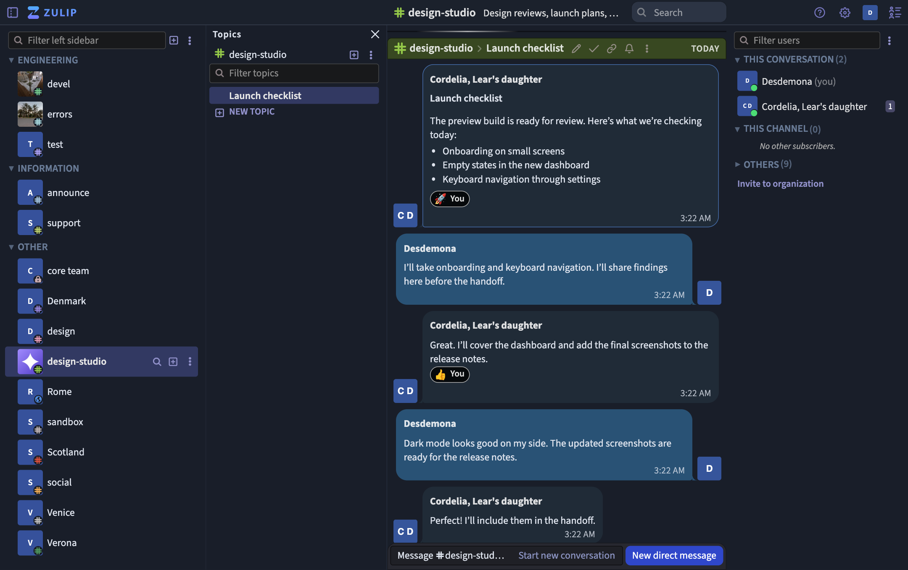

# Zulip Fork

A fork of [Zulip](https://github.com/zulip/zulip) with a redesigned web interface, more control over regional display settings, and new options for channel pictures and reaction notifications.

_The Modern interface in dark mode, showing a sample launch-planning conversation._

## What this fork adds

- **Classic and Modern interfaces**. Switch layouts under **Personal settings → Preferences → General → Web interface**. Zulip saves your choice to your account.
- **Redesigned conversations**. In Modern, scan incoming and outgoing message bubbles, and see animated typing indicators. Users without a profile photo get initials in their avatar.
- **Pinned conversations and Saved Messages**. Pin direct messages in the sidebar and open Saved Messages from **Views** to keep notes and files.
- **Custom channel pictures**. Channel administrators can upload, crop, replace, or remove a picture in channel settings. The picture appears beside the channel name in the sidebar.
- **Emoji reactions and notifications**. Find recently used emoji in the picker. Eligible reactions can notify the message author on desktop or mobile, and organization administrators can disable reaction notifications.
- **Calendar, time zone, and fonts**. Choose a Jalali, Gregorian, Islamic civil, or Hebrew calendar. Set a display time zone or follow your device, and pick a Persian font such as Vazir, Sahel, or Samim.
- **Drafts saved before reload**. Keep in-progress messages when the web app reloads to apply an update.

## Getting started

- **Use this fork**. Start with the [fork’s releases](https://github.com/mlkmhd/zulip/releases).
- **Develop locally**. Follow Zulip’s [development setup guide](https://zulip.readthedocs.io/en/latest/development/overview.html) from a checkout of this fork.
- **Learn about upstream Zulip**. See the [official repository](https://github.com/zulip/zulip) and [self-hosting documentation](https://zulip.com/self-hosting/).

Zulip and this fork are distributed under the [Apache 2.0 license](https://github.com/mlkmhd/zulip/blob/main/LICENSE).
