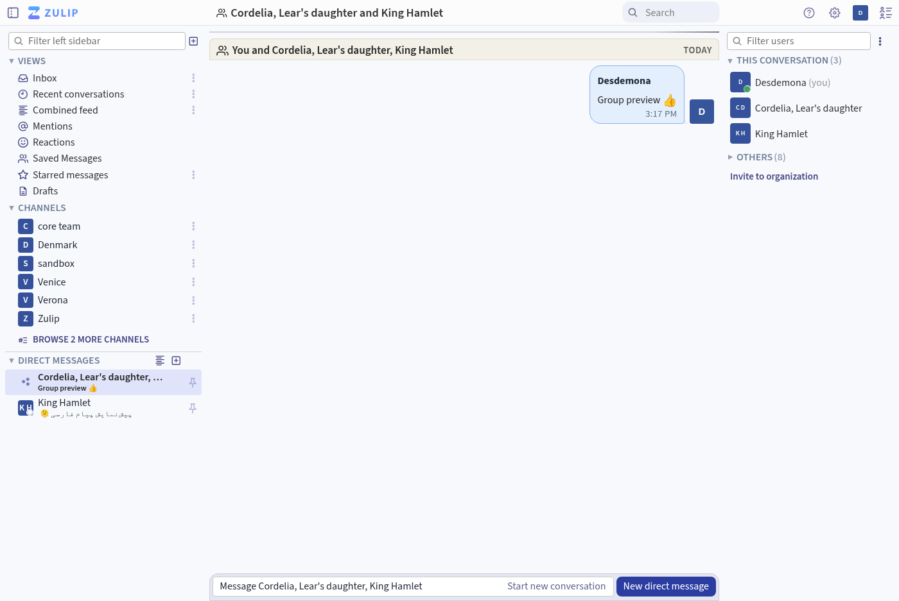
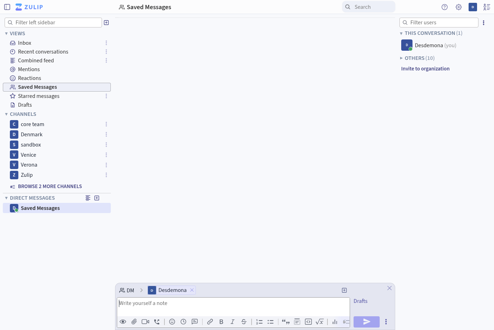

## Changes since the fork's 12.6.6 release

- Restored the Views section of the sidebar, with Saved Messages alongside the other views.
- Direct message previews now show group conversations and update when you send a message. Previews preserve emoji and give Persian text more vertical space.
- Channel pictures use the full space in the sidebar. The channel picker still displays channel privacy icons.
- Improved positioning of the sender's user card and expanded automated coverage for fork features.
- Included the upstream 13.1 fix for update announcements. This fork retains its current upstream main base, API feature level, and fork-specific migrations.

## Screenshots

### Direct message previews

### Saved Messages in Views

